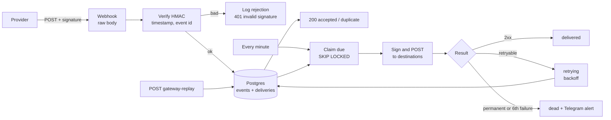

# Webhook Gateway for n8n: HMAC Verification, Idempotency, Retries and Dead-Letter Queue

> One public endpoint that receives webhooks **safely** (signature checked over the raw bytes, replays rejected, each event stored once) and forwards them **reliably** (fan-out to many destinations, exponential backoff, dead-letter queue, one-call replay).


## Table of contents

1. [What it does](#what-it-does)
2. [Architecture](#architecture)
3. [How it works](#how-it-works)
4. [Setup](#setup)
5. [Signature schemes](#signature-schemes)
6. [Operating it](#operating-it)
7. [Security](#security)
8. [Testing](#testing)
9. [Troubleshooting](#troubleshooting)
10. [Limitations](#limitations)
11. [Roadmap](#roadmap)

## What it does

| Part | Behavior |
|---|---|
| **Ingest** | `POST /webhook/gateway-ingest?source=<name>`. The HMAC-SHA256 signature is verified over the raw request bytes. Supported: GitHub, Stripe and a generic scheme for your own services. |
| **Replay protection** | Stripe and generic requests carry a timestamp that must be within a tolerance (default 5 min). Every event is stored once per `(source, event id)`. |
| **Durable ack** | The `200` is sent only after the event is stored. If the database is down the sender gets an error and retries by itself. A provider retry of an already stored event gets `200 duplicate`. |
| **Fan-out** | Each source can have many destinations. One delivery row per event and destination. |
| **Delivery worker** | Every minute: claims due deliveries (`FOR UPDATE SKIP LOCKED`), re-signs them with the destination's own secret and POSTs them. |
| **Retries** | Backoff of 1 min, 5 min, 15 min, 1 h and 3 h (±20 % jitter), 6 attempts in total. `Retry-After` is honored up to 6 h. Timeouts, network errors, 408, 425, 429 and 5xx are retried. Other 4xx and redirects are not retried. |
| **Dead-letter queue** | After the last attempt a delivery becomes `dead` and you get one Telegram alert with the error and the replay instruction. |
| **Replay** | `POST /webhook/gateway-replay {"delivery_id": N}` (Header Auth) puts a dead delivery back in the queue with a fresh attempt counter. |
| **Cleanup** | Daily: delivered events older than 30 days are deleted. Dead ones are kept for 90 days. Rejection logs are kept for 7 days. |

## Architecture



## How it works

### Raw body

A signature covers exact bytes. Re-serializing parsed JSON changes whitespace and key order and breaks the check, so the Webhook node has **Raw Body** enabled and the signature is computed over the bytes received. Bodies must be valid UTF-8 text without NUL (stored in a Postgres `text` column) and at most 1 MB.

### One answer for every failure

Unknown source, disabled source, missing header and wrong signature all return the same `401 invalid signature`. A scanner cannot tell which source names exist. Detailed reasons (`timestamp outside tolerance`, `signature mismatch`) go only to the `rejections` table, which is capped at 100 rows per minute so it cannot be used to fill the disk. Detailed errors such as `missing event id` are returned only after the signature has been verified.

### Idempotency

`UNIQUE (source, event_id)` plus `ON CONFLICT DO NOTHING`. The event id comes from `X-GitHub-Delivery`, the Stripe `id` field, or `X-Event-Id` (generic; if absent, the SHA-256 of the body, so identical bodies count as one event). The event and its deliveries are inserted in **one SQL statement**, so there is no state where an event exists without its deliveries.

### Delivery state machine

```
pending ─claim→ delivering ─2xx→ delivered
                   │
                   ├─retryable→ retrying ─claim→ delivering ...
                   └─permanent / attempts used up→ dead ─replay→ pending
```

- The claim increments `attempts` and sets a 2-minute lock. If a worker crashes, the lock expires and the delivery is claimed again, and that counts as an attempt.
- Results are saved with `WHERE status = 'delivering'`, so a late or duplicate result cannot overwrite a newer state.
- Delivery is **at least once**. Destinations must tolerate duplicates; every request carries `X-Gateway-Event-Id` and `X-Gateway-Delivery` for that purpose.

### What destinations receive

The original body, unchanged, with the original content type and these headers:

| Header | Meaning |
|---|---|
| `X-Gateway-Source`, `X-Gateway-Event-Id`, `X-Gateway-Event-Type` | Origin and ids |
| `X-Gateway-Delivery`, `X-Gateway-Attempt` | Delivery id and attempt number |
| `X-Gateway-Signature` | `t=<unix>,v1=<hmac>` over `<t>.<body>`, only if the destination has a secret |

Redirects are not followed and each request has a 15 s timeout.

## Setup

### Requirements

- n8n 1.x, publicly reachable over HTTPS for the ingest URL
- PostgreSQL 13+
- A Telegram bot and chat id for alerts

### Steps

1. Run [`sql/schema.sql`](sql/schema.sql).
2. Import `workflows/webhook_gateway.json`.
3. Create credentials: Postgres, Telegram, and Header Auth named `Gateway replay key` (header `Authorization` or `X-API-Key` with a long random value).
4. Replace `REPLACE_WITH_ALERT_CHAT_ID` (3 nodes) and the `REPLACE_ID` credential slots.
5. Add a source and destination (see [`sql/example_sources.sql`](sql/example_sources.sql)):

   ```sql
   INSERT INTO sources (name, scheme, secret) VALUES ('github', 'github', '<openssl rand -hex 32>');
   INSERT INTO destinations (source, name, url) VALUES ('github', 'ci', 'https://ci.example.com/hooks/github');
   ```
6. Set the **Error Workflow** in Workflow Settings to this workflow.
7. Point the provider at `https://<your-n8n>/webhook/gateway-ingest?source=github` with the same secret, send a test event, then activate. While testing use the *test* URL (`/webhook-test/...`).

Behind a proxy, make sure it forwards the body unmodified and sets `X-Forwarded-For` if you want client addresses in the rejection log.

## Signature schemes

| Scheme | Header(s) | Signed text | Event id | Timestamp |
|---|---|---|---|---|
| `github` | `X-Hub-Signature-256: sha256=<hex>` | body | `X-GitHub-Delivery` (required) | none (dedupe only) |
| `stripe` | `Stripe-Signature: t=<unix>,v1=<hex>[,v1=...]` | `<t>.<body>` | JSON `id` | `t`, tolerance applies |
| `generic` | `X-Signature: <hex>` (or `sha256=<hex>`), `X-Timestamp: <unix>` | `<X-Timestamp>.<body>` | `X-Event-Id`, else SHA-256 of body | required, tolerance applies |

Sending to the gateway from your own service (generic):

```bash
BODY='{"order":42}'; TS=$(date +%s)
SIG=$(printf '%s.%s' "$TS" "$BODY" | openssl dgst -sha256 -hmac "$SECRET" -hex | sed 's/^.* //')
curl -X POST "https://n8n.example.com/webhook/gateway-ingest?source=myapp" \
  -H "Content-Type: application/json" -H "X-Timestamp: $TS" -H "X-Signature: $SIG" \
  -H "X-Event-Id: order-42-created" -d "$BODY"
```

Verifying the gateway's own signature at a destination: compute HMAC-SHA256 over `<t>.<raw body>` with the destination secret, compare in constant time, and reject if `t` is older than a few minutes.

## Operating it

```sql
-- Queue overview
SELECT * FROM delivery_stats;

-- Dead deliveries and why
SELECT d.id, e.source, x.name AS destination, d.attempts, d.last_status, d.last_error
FROM deliveries d JOIN events e ON e.id = d.event_id JOIN destinations x ON x.id = d.destination_id
WHERE d.status = 'dead' ORDER BY d.id DESC;

-- Recent rejections
SELECT created_at, source, reason, ip FROM rejections ORDER BY id DESC LIMIT 50;

-- Rotate a secret: change it here and at the provider, then run a test event
UPDATE sources SET secret = '<new>' WHERE name = 'github';
```

Replay after fixing a destination:

```bash
curl -X POST https://n8n.example.com/webhook/gateway-replay \
  -H "Authorization: <your key>" -H "Content-Type: application/json" -d '{"delivery_id": 42}'
```

## Security

- **Authentication is the signature.** Compared in constant time. Malformed headers, SHA-1 signatures and signatures over a different timestamp are rejected.
- **Secrets are stored in the database.** Anyone who can read the `sources` table can forge events. Restrict database access and use disk encryption. Secrets are never written to logs, the rejection table or responses.
- **Destinations are trusted configuration.** The gateway deliberately allows internal URLs (that is a main use case), so whoever can write to `destinations` can make your n8n server call any address. Keep write access to that table limited.
- **Replay endpoint** requires Header Auth and accepts only a positive integer id.
- **No amplification of bad input:** payload size is capped at 1 MB, rejection logging at 100 per minute, delivery batches at 20 per run.
- **Payloads can contain personal data.** They are stored for 30 days (90 for dead ones). Adjust retention to your obligations.
- **GitHub deliveries have no timestamp**, so replay protection there is the event id only. A captured request replayed after cleanup would be accepted as new.

## Testing

- **Code nodes: 266 checks.** SHA-256 and HMAC-SHA256 (pure JavaScript, no `require`) against Node's `crypto` for 15 input sizes around the padding boundaries, 45 key/message combinations and known vectors. All three schemes: valid, wrong secret, tampered body, stale and future timestamps, tolerance clamping, multiple Stripe signatures, missing or invalid event ids, content-type sanitizing. Request preparation (oversized, non-UTF-8, NUL, BOM, multibyte), outgoing signatures verified independently, the retry classifier (every status class, backoff windows over 200 samples per attempt, `Retry-After`), replay parsing, alerts and workflow structure.
- **SQL: 59 checks on a real PostgreSQL engine (PGlite):** constraints, idempotent store with fan-out, claim semantics (due, not due, live and expired locks, batch limit), the state machine, replay, cleanup rules and cascades. The SQL under test is read from the shipped workflow file.

Not verified: a live n8n instance, real GitHub or Stripe deliveries, Telegram, and **concurrent workers**. PGlite is single-connection, so `FOR UPDATE SKIP LOCKED` is syntactically exercised but not under real contention. The raw-body option and binary handling follow the n8n documentation; send one real signed test event before going live.

## Troubleshooting

| Problem | Fix |
|---|---|
| Every request returns 401 | Wrong secret, wrong `source` name, or a proxy that alters the body. Check `rejections.reason`. |
| `timestamp outside tolerance` | Clock drift on the sender or the server. Fix NTP, or raise `tolerance_seconds` (max 86400). |
| GitHub test works, Stripe fails | Use the endpoint signing secret (`whsec_...`) of that exact endpoint, not the API key. |
| Events stored but never delivered | The source has no enabled destination, or the delivery workflow is inactive. |
| Same delivery attempted twice | Expected after a crash or a timeout where the destination did process the request. Deduplicate on `X-Gateway-Event-Id`. |
| 415 unsupported payload | The body is not UTF-8 text (for example binary uploads). Not supported. |
| Replay returns 404 | The delivery is not `dead`, or the id does not exist. |

## Limitations

- Text payloads up to 1 MB only.
- Destinations are managed with SQL; there is no UI.
- No per-destination rate limit or ordering guarantees (deliveries are independent).
- No per-source rate limiting at the gateway. Put a reverse proxy or WAF in front for volumetric abuse.
- Retry schedule and attempt count are constants in the *Classify Results* node.

## Roadmap

- Event filtering and payload transformation per destination
- Per-destination circuit breaker
- Management webhook for sources and destinations
- Metrics endpoint (queue depth, oldest due, dead count)

## License

MIT. Add a `LICENSE` file to your repository.
